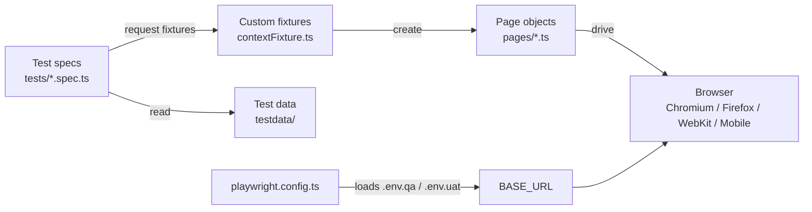

# SauceDemo Playwright Automation Framework

[](https://github.com/poojachanapannavar123-maker/saucedemo-playwright-framework/actions/workflows/playwright.yml)


An end-to-end UI test automation framework for the [SauceDemo](https://www.saucedemo.com) e-commerce app, built with **Playwright** and **TypeScript**. It uses the Page Object Model, custom fixtures, data-driven tests, environment-based configuration (QA / UAT), and a GitHub Actions CI pipeline that runs across desktop and mobile browsers.

---

## Table of contents

- [Key features](#key-features)
- [Tech stack](#tech-stack)
- [Project structure](#project-structure)
- [Framework architecture](#framework-architecture)
- [Test coverage](#test-coverage)
- [Getting started](#getting-started)
- [Running tests](#running-tests)
- [Environments and test data](#environments-and-test-data)
- [CI/CD pipeline](#cicd-pipeline)
- [Reports and debugging](#reports-and-debugging)
- [Roadmap](#roadmap)
- [Author](#author)

---

## Key features

- **Page Object Model**: each page's locators and actions live in their own class under `pages/`.
- **Custom fixtures**: page objects and a reusable `loginAs()` helper are injected into tests through `test.extend`, so tests never create page objects by hand.
- **Data-driven tests**: the same scenarios run for every user defined in the test data.
- **Multi-environment support**: switch between QA and UAT with one `ENV` variable. Each environment has its own `.env` file and its own test data.
- **Cross-browser and mobile**: Chromium, Firefox, WebKit, Pixel 5 and iPhone.
- **Tagged suites**: run `@smoke`, `@regression`, or a single feature such as `@login`, `@products` or `@pdp`.
- **Accessible locators**: built mainly on `getByRole`, `getByPlaceholder` and `data-test` attributes, which are more stable than CSS or XPath.
- **Failure evidence**: screenshots on failure and traces on retry.
- **CI/CD**: GitHub Actions runs the suite on every push and pull request, can be triggered manually for QA or UAT, and uploads the HTML report as a build artifact.

## Tech stack

| Area | Tool |
|---|---|
| Test runner and browser automation | [Playwright Test](https://playwright.dev) |
| Language | TypeScript |
| Runtime | Node.js (LTS) |
| Configuration | dotenv |
| CI/CD | GitHub Actions |
| Reporting | Playwright HTML report |

## Project structure

```
.
├── .github/workflows/
│   └── playwright.yml        # CI pipeline (push, PR, manual QA/UAT run)
├── fixtures/
│   └── contextFixture.ts     # Custom fixtures: page objects + loginAs()
├── pages/                    # Page Object Model classes
│   ├── loginPage.ts
│   ├── productsPage.ts
│   ├── productDetailsPage.ts
│   └── cartPage.ts
├── tests/                    # Test specs, grouped by feature
├── testdata/
│   ├── credentials.json      # Users and test data per environment
│   └── credentials.ts        # Loads data for the active environment (or CI secrets)
├── utils/
│   └── helper.ts             # Shared helpers (e.g. random index)
├── .env.example              # Template for .env.qa / .env.uat
├── playwright.config.ts      # Browsers, timeouts, retries, reporter, env loading
└── package.json              # npm scripts for each suite / browser / env
```

## Framework architecture



**How a test runs:**

1. `playwright.config.ts` reads `ENV` (default `qa`), loads the matching `.env.<env>` file, and fails fast if `BASE_URL` is missing.
2. The test asks for fixtures such as `loginAs`, `productsPage` and `cartPage`. The fixture file creates those page objects for it.
3. Test data (users, product keywords) comes from `testdata/` for the active environment. In CI, credentials come from GitHub Secrets instead.
4. Page objects perform the actions and verify the page state.

**Example test:**

```ts
test(
  "Successful login",
  { tag: ["@login", "@smoke"] },
  async ({ loginAs, productsPage }) => {
    await loginAs(user.userName, user.password);
    await productsPage.verifyproductListVisible();
  }
);
```

## Test coverage

| Feature | Scenarios covered | Tags |
|---|---|---|
| Login | Valid login for each test user, invalid credentials error, locked-out user error | `@login` `@smoke` `@regression` |
| Products listing | Product list shows 6 items, open a random product, add a random product to cart, cart badge counts from 1 to 6, find a product by name | `@products` `@smoke` `@regression` |
| Product details (PDP) | Name, price, image and description match the listing; Add to cart toggles to Remove and updates the badge; Back to Products navigation | `@pdp` `@regression` |
| Cart | Added product is shown in the cart along with the Remove, Continue Shopping and Checkout buttons | `@smoke` |

Every scenario runs for each configured test user on **5 browser/device projects**.

## Getting started

### Prerequisites

- [Node.js](https://nodejs.org) 18 or later (LTS recommended)
- Git

### Installation

```bash
git clone https://github.com/poojachanapannavar123-maker/saucedemo-playwright-framework.git
cd saucedemo-playwright-framework
npm ci
npx playwright install --with-deps
```

### Environment setup

Create the environment files from the template. These files are git-ignored.

```bash
cp .env.example .env.qa
cp .env.example .env.uat
```

Each file needs a `BASE_URL` (for example `https://www.saucedemo.com`).

## Running tests

| Command | What it does |
|---|---|
| `npm test` | Run all tests on all projects (QA by default) |
| `npm run smoke` | Run only `@smoke` tests |
| `npm run regression` | Run only `@regression` tests |
| `npm run chromium` / `firefox` / `webkit` | Run on a single browser |
| `npm run headed` | Run with the browser visible |
| `npm run report` | Open the last HTML report |
| `npx playwright test --ui` | Open Playwright UI mode for interactive debugging |
| `npx playwright test --grep @login` | Run one feature by tag |

**Run against UAT:**

```bash
# macOS / Linux
ENV=uat npx playwright test

# Windows PowerShell
$env:ENV="uat"; npx playwright test
```

## Environments and test data

| Source | Used for |
|---|---|
| `.env.qa`, `.env.uat` | `BASE_URL` for local runs |
| `testdata/credentials.json` | Test users and product keywords per environment (local runs) |
| GitHub Variables `BASE_URL_QA`, `BASE_URL_UAT` | `BASE_URL` in CI |
| GitHub Secrets `USERNAME`, `PASSWORD` | Test user credentials in CI |

Real secrets are never committed. `.env*` files are git-ignored, except `.env.example`.

## CI/CD pipeline

The workflow in [`.github/workflows/playwright.yml`](.github/workflows/playwright.yml):

- **Triggers:** every push and pull request to `main`, plus manual runs (*Actions → Playwright Tests → Run workflow*) where you choose **QA** or **UAT**.
- **Steps:** check out the code, set up Node LTS, `npm ci`, install the Playwright browsers, run the tests with environment variables and secrets, then upload the HTML report as an artifact (kept 30 days).
- **CI-specific settings:** 2 retries, 1 worker, and `forbidOnly` so a stray `test.only` can't slip through.

To view a report from CI, open a workflow run and download the **playwright-report** artifact.

## Reports and debugging

- **HTML report:** `npm run report`
- **Screenshots:** captured automatically on failure
- **Traces:** recorded on the first retry; open them with `npx playwright show-trace <trace.zip>` or from the HTML report
- **UI mode:** `npx playwright test --ui` for step-by-step debugging

<!-- Add a screenshot of your HTML report here:

-->

## Roadmap

- [ ] End-to-end checkout flow (checkout info, overview, order confirmation, price and tax checks)
- [ ] Product sorting tests (name A–Z / Z–A, price low–high / high–low)
- [ ] Logout, burger menu and Reset App State tests
- [ ] Tests that catch the defects of `problem_user`, `error_user` and `performance_glitch_user`
- [ ] Visual regression testing with `toHaveScreenshot()`
- [ ] Accessibility checks with `@axe-core/playwright`
- [ ] Reuse the login session (`storageState`) to speed up the suite
- [ ] API tests with Playwright's `request` fixture
- [ ] ESLint and Prettier
- [ ] Sharded CI runs, a nightly regression schedule, and a report published to GitHub Pages

## Author

**Pooja Chanapannavar**: [GitHub](https://github.com/poojachanapannavar123-maker) · [LinkedIn](https://www.linkedin.com/in/your-profile)

## License

This project is licensed under the [MIT License](LICENSE).
